# Appendix E: Source Code, Installation Guide and Further Screenshots

*Appendix to the BSc (Hons) Computer Science thesis "Development of a Real-Time Availability and Booking System for Communal Gym Facilities" by Dewan Sayeed Raja (P2863738).*

The complete GymZone source code is held in this repository. It contains the application source code, the database script (`database/schema.sql`), project documentation, screenshots and the test suite. The full installation and usage guide is in the [README](../README.md).

## Table E.1. Main contents of the repository

| Path | Purpose |
|---|---|
| app/core/ | Application infrastructure: authentication, database access, clock, validation, rate limiting and views. |
| app/services/ | Business rules and services for bookings, availability, attendance, schedules, residents, accounts, email and maintenance. |
| api/ | JSON endpoints used by resident and administrator actions. |
| database/schema.sql | Database schema, generated columns, keys and constraints. |
| assets/ | Responsive CSS and browser-side JavaScript. |
| docs/ | Architecture, testing documentation and interface screenshots. |
| tests/run_tests.php | Automated functional test suite. |
| tests/responsive_check.py | Automated responsive-layout check. |
| README.md | Installation, configuration and usage guide. |

## Installation summary

1. Use PHP 8.1 or later with MySQL/MariaDB; the project is designed to run on a standard XAMPP installation.
2. Copy the project folder into XAMPP's `htdocs` folder as `gymzone` and, if needed, adjust the database settings in `config/config.php` or with environment variables.
3. Open `http://localhost/gymzone/install.php` (or run `php scripts/install.php`) to create the database tables, the first administrator account and optional sample data.
4. Mailpit is used during development and testing to capture application emails without sending real messages.
5. Run `php tests/run_tests.php` to rebuild the separate test database and execute the automated functional test suite.

## Further screenshots

**Resident dashboard on a desktop screen**

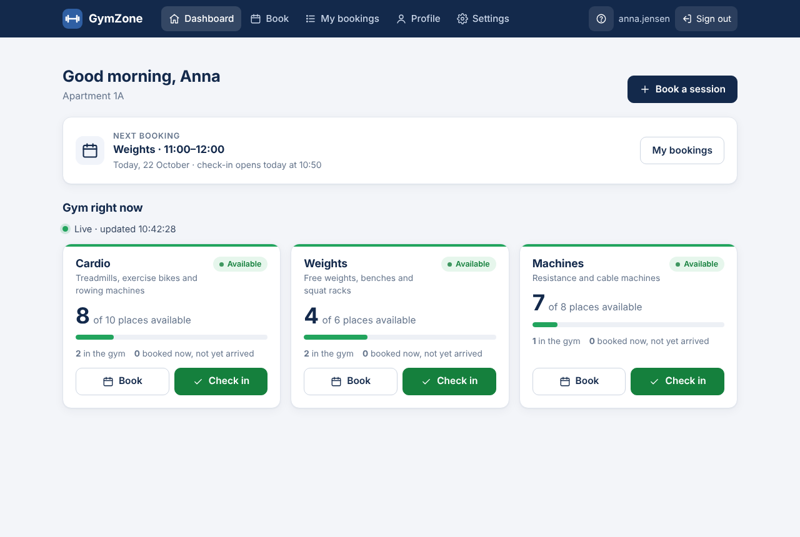

**Resident dashboard while checked in (phone)**

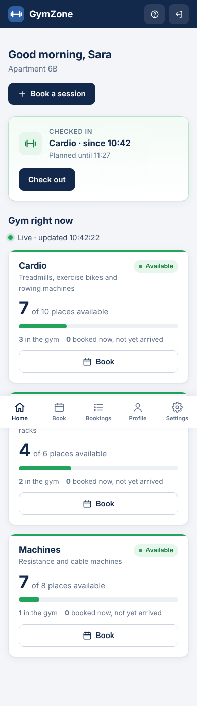

**Walk-in check-in (phone)**

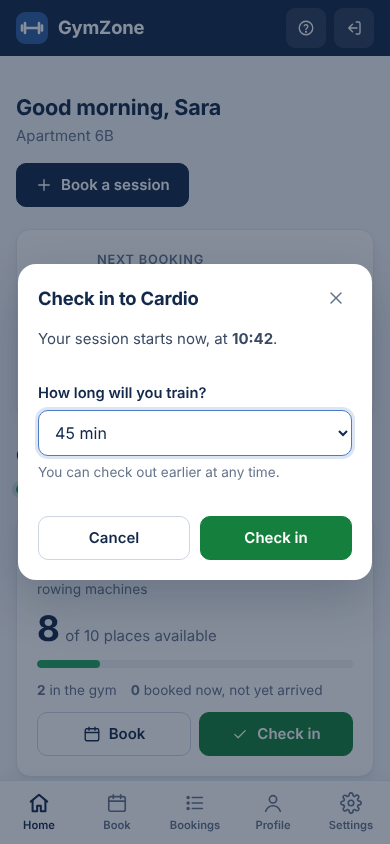

**Booking page (phone)**

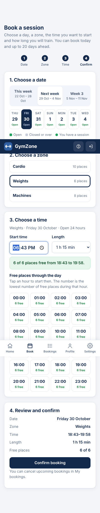

**Booking page (desktop)**

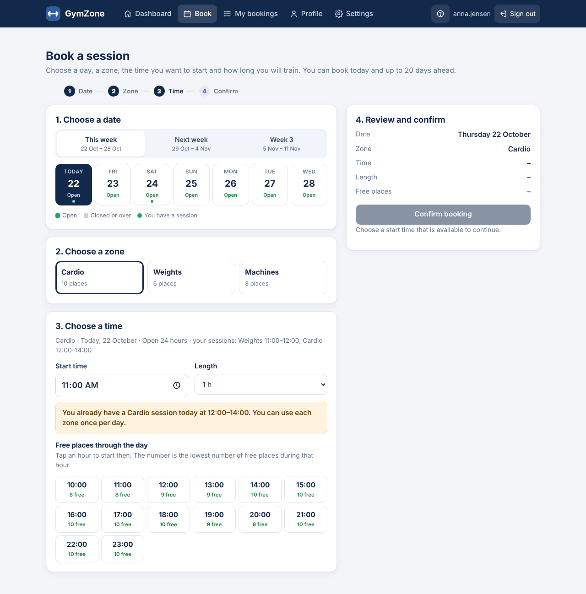

**Completed bookings with real times (phone)**

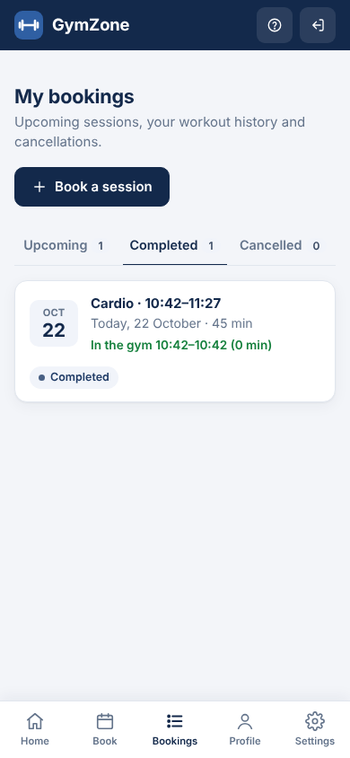

**Check-out confirmation (phone)**

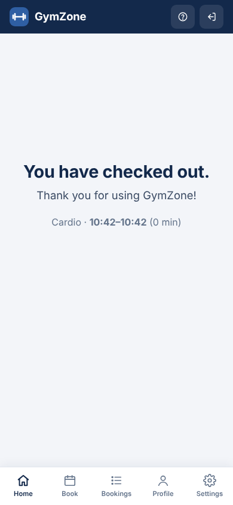

**Profile (phone)**

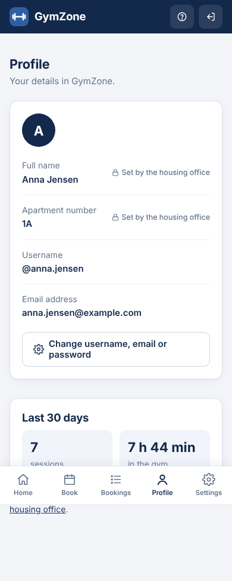

**Settings (phone)**

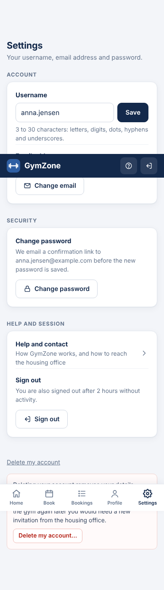

**Account deletion (phone)**

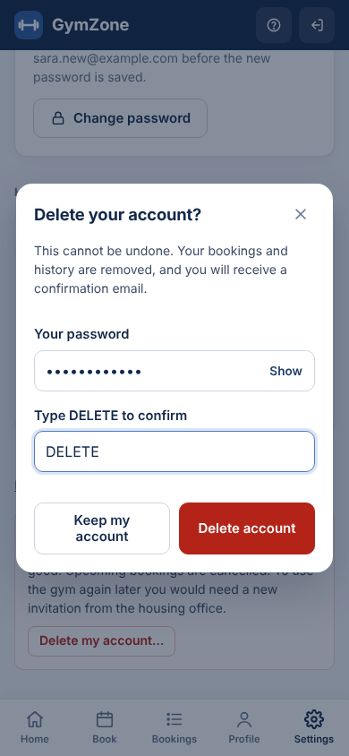

**Help and contact for signed-in residents (phone)**

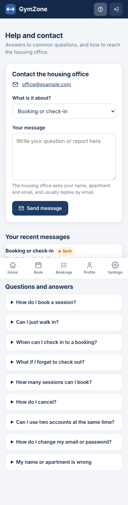

**Sign-in page (phone)**

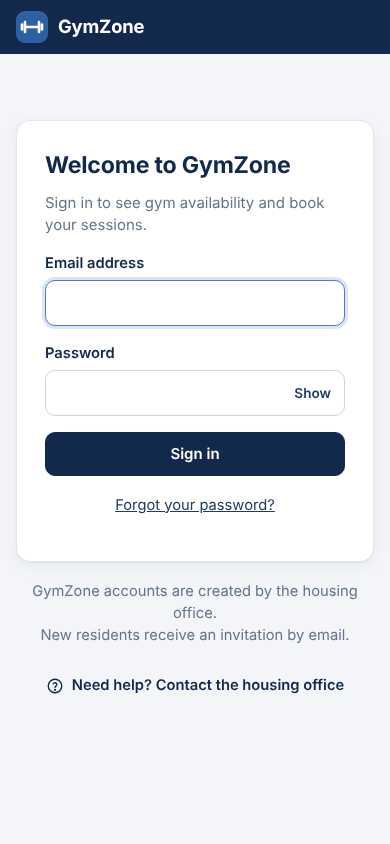

**Notice when a second account signs in from the same browser**

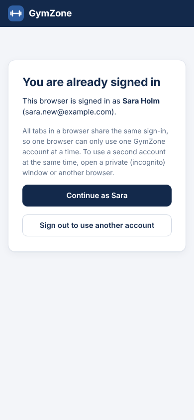

**Administrator overview (phone)**

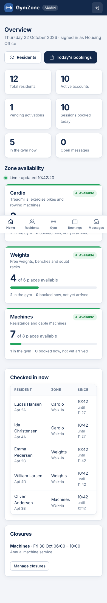

**Administrator bookings with checked-in residents (phone)**

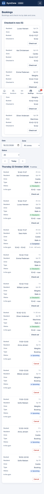

**Administrator messages (phone)**

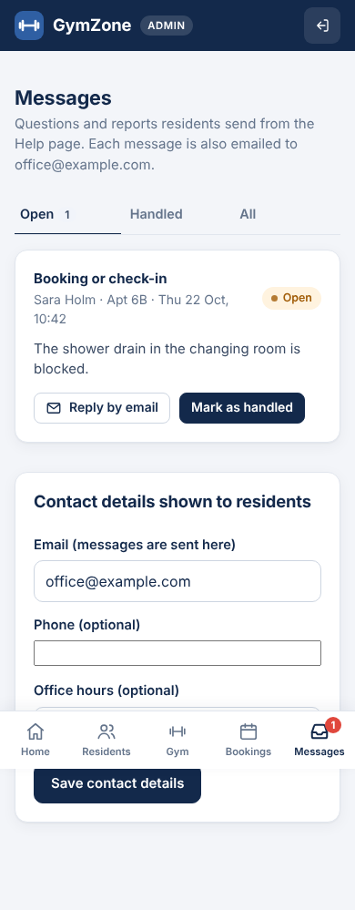

**Activation email captured in Mailpit**

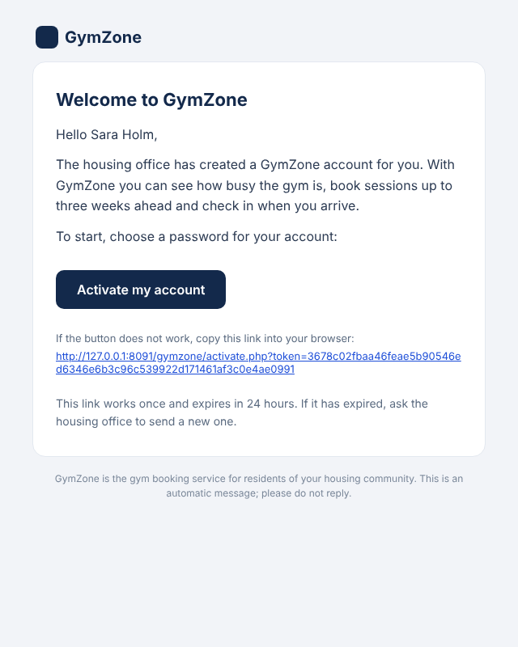

**Web installer**

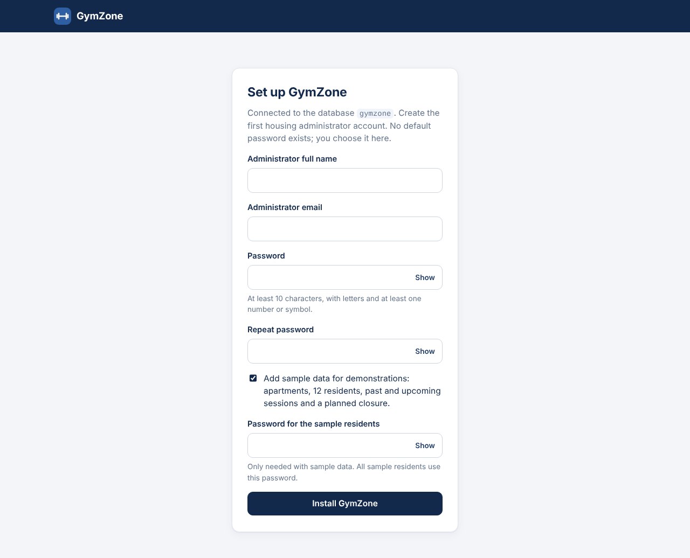

---
[Back to the list of appendices](README.md) · [Back to the repository](../README.md)
