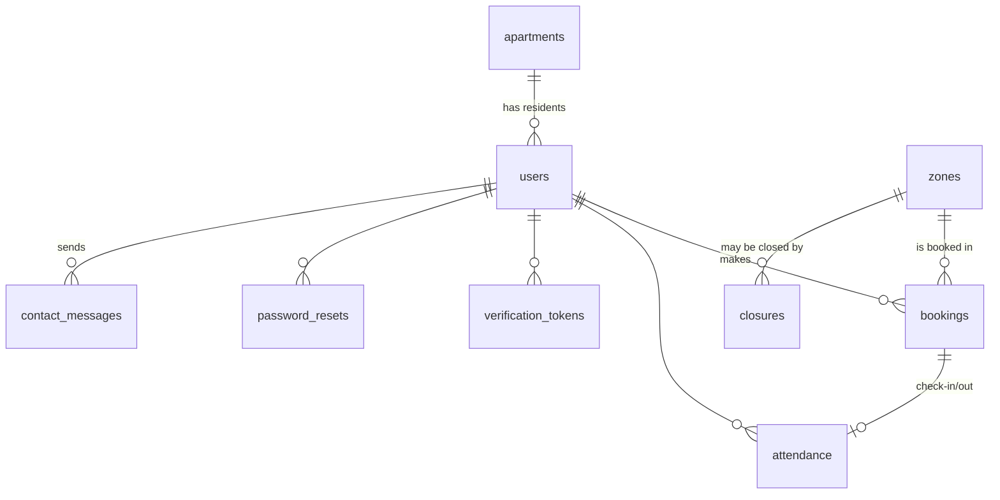

# GymZone architecture

## 1. Overview

GymZone is a server-rendered PHP application with small JavaScript enhancements. Pages are rendered by PHP; actions (booking, check-in, admin changes) are sent with the Fetch API to JSON endpoints. All rules are enforced on the server.

```
 Browser (HTML5, CSS3, vanilla JS)
   │  page requests (GET/POST forms)          JSON requests (fetch + X-CSRF-Token)
   ▼                                           ▼
 Pages  login.php, dashboard.php,          API endpoints  api/*.php, api/admin/*.php
        book.php, admin/*.php …                    │
   │                                               │
   └──────────────► app/bootstrap.php ◄────────────┘
                    (autoload, security headers, error handling,
                     session start, maintenance)
                              │
            ┌─────────────────┼──────────────────────┐
            ▼                 ▼                      ▼
     app/core           app/services            app/views
     Auth, Http,        Bookings, Attendance,   Components
     Db, View,          Availability, Schedule, (zone card,
     Validator,         Zones, Residents,        booking item,
     RateLimiter,       Account, Contact,        durations)
     Clock              Tokens, Mailer,
                        EmailTemplates, Settings,
                        Installer, Upgrade
            │                 │
            ▼                 ▼
     MySQL / MariaDB     Mailpit HTTP API (POST /api/v1/send via cURL)
     (PDO, InnoDB)
```

### Layers

| Layer | Folder | Responsibility |
|---|---|---|
| Pages | project root, `admin/` | Check access, load data from services, render HTML with the shared layout (`View::header()`/`footer()`). |
| API endpoints | `api/`, `api/admin/` | Check role and CSRF, read JSON input, call one service method and return `{ok, …}` or `{ok: false, error}`. `Http::api()` turns rule errors (`UserError`) into friendly JSON messages with suitable status codes. |
| Services | `app/services/` | All business rules and database queries, grouped by subject. Pages and endpoints never contain SQL for rules. |
| Core | `app/core/` | Framework-like helpers: configuration, PDO wrapper with transactions, sessions and roles, CSRF, request/response, validation, rate limiting, escaping and layout, a controllable clock. |
| Front end | `assets/js/` | `core.js` provides `GZ.api()` (fetch with CSRF header and error handling), toasts, confirmation modals, loading states and tabs. One small script per page adds that page's behaviour. |
| Styles | `assets/css/app.css` | One stylesheet with design tokens (navy, white, grey, green), components and breakpoints at 1060, 960 and 760 px. The layout is mobile-first: on phones, residents and administrators get a bottom tab bar. |

### Request life cycle

1. `app/bootstrap.php` registers the autoloader and sets the time zone. It sends security headers and installs an error handler (a friendly page or JSON, with details logged). It checks that the database is installed and upgrades an older database if needed (`Upgrade::run()`). Then it starts the session and runs `Maintenance::run()`.
2. The page or endpoint calls `Auth::requirePage('resident'|'admin')` or `Auth::requireApi(...)`. These enforce the role, and the API version also checks the CSRF token on POST.
3. A service method validates input (`Validator`), applies rules inside `Db::transaction()` and throws `UserError` with a readable message when a rule is broken.
4. The page renders HTML, or the endpoint returns JSON. After a successful admin change, endpoints may set a flash message that the reloaded page shows.

## 2. Data model



| Table | Purpose and key constraints |
|---|---|
| `apartments` | Apartment numbers (unique). Several residents can belong to one apartment. |
| `users` | Residents and administrators. Key columns: `role` (resident or admin), `status` (pending, active or inactive), `password_hash` (NULL while pending), `apartment_id`, and `session_version` (raised on a password change to sign out other devices). Email and username are unique. CHECK constraints: a resident must have an apartment, and an active account must have a password. |
| `zones` | Name, description, capacity (1–500). `is_open = 0` closes a zone until it is reopened. |
| `operating_hours` | One row per ISO weekday (1 = Monday): open flag, opening and closing time. The default is 00:00–24:00 every day (open around the clock). |
| `closures` | Planned closures of the whole gym (`zone_id` NULL) or one zone, with a reason. |
| `bookings` | One row per resident per session, for both bookings and walk-ins (`source`). `start_at` and `end_at` are the planned times, chosen to the minute; a walk-in starts at the minute of check-in. Status: booked, checked_in, completed, cancelled or released. The stored generated column `day_key` equals the date while a booking counts and is NULL once it is cancelled or released. The unique key `(user_id, zone_id, day_key)` therefore enforces "one session per zone per resident per day" in the database itself. |
| `attendance` | The real check-in and check-out times, which can differ from the planned times (for example when leaving early). `auto_checked_out` marks an automatic check-out after 6 hours, and `checkout_reported_at` records when the resident reported the real time. The generated column `active_user` (the user while not checked out) has a unique key, so a resident can never have two active check-ins. |
| `verification_tokens` | Activation, email-change and password-change links: a SHA-256 hash of the token, an expiry, and the time it was used. A requested new email address, or the new password (already hashed), waits here until confirmed. |
| `password_resets` | Forgotten-password links (hashed, expiring, single use) with the requesting IP address. |
| `rate_limits` | Attempt log used for rate limiting. |
| `contact_messages` | Messages residents send from Help, with subject, text, sender details and whether an administrator has handled them. |
| `settings` | Session lengths, check-in rules, automatic check-out hours, booking window, contact details and schema version. |

The full schema with comments is in `database/schema.sql`.

## 3. Key mechanisms

### Time model and availability

Sessions are not fixed slots. A resident chooses any start minute and a length (15 minutes up to the longest session). The question for every rule is therefore "what happens during this exact period?":

- **Open:** `Schedule::isOpenDuring(start, end)` joins the opening periods of neighbouring days. A session can run past midnight when both days are open.
- **Free places:** the zone's capacity minus the *highest number of people present at the same moment* during the period. `Availability::peak()` sorts the start and end times of all overlapping sessions (bookings not yet checked in, and residents checked in) and walks through them, counting people in and out. A resident who is still checked in after the planned end counts until now.
- `Availability::fullFrom()` finds the first moment the zone becomes full. Messages can then say "Weights is full from 16:00; you can choose a shorter session, until 16:00".
- A booked resident who checks in keeps the same row, so nobody is counted twice.

What the screens show:

- **Dashboard:** who is in each zone now (checked in, plus booked sessions running now).
- **Booking page:** an hour-by-hour overview with the lowest number of free places in each hour, and a live check of the exact time the resident types (`?view=check`). The check uses the same `Bookings::evaluate()` as the booking itself.

### Booking (`Bookings::create`)

1. Outside the transaction:
   - the length must be between 15 minutes and the maximum, in 5-minute steps;
   - the start must be in the future, between today and today + 20 days.
2. Inside a transaction, in this order:
   1. lock the resident row (`SELECT … FOR UPDATE`);
   2. lock the zone row;
   3. run `evaluate()`, which checks:
      - the gym is open for the whole period;
      - the zone is open and not affected by a closure;
      - the resident has no other session in this zone that day;
      - the resident has no overlapping session;
      - the peak number of people stays below capacity;
   4. insert the booking.
3. The locks make two simultaneous requests for the last place run one after the other. The unique key on `day_key` is a second safety net. A test runs 8 processes against 3 free places and confirms exactly 3 succeed.

### Check-in and check-out (`Attendance`)

- **Check-in with a booking:** allowed from `checkin_early_minutes` before the booked start until `checkin_grace_minutes` after it.
- **Walk-in:** starts at the current minute (13:52 gives 13:52–14:52 with the default hour). The resident can choose another length. If they have a booking for that zone that can be checked in now, they are simply checked in to it.
- **Check-out:** records the exact time, marks the booking completed and frees the place immediately. The thank-you screen and the resident's history show the real time in the gym (for example 13:52–14:20, 28 min). Administrators see the same, marked "left early" or "stayed longer".
- **Automatic steps** (`Maintenance::run()`, on every request and in `scripts/maintenance.php`):
  - it releases bookings not checked in within the check-in period;
  - it checks out anyone still checked in after `auto_checkout_hours` (6). It records the time as check-in + 6 h and sets `auto_checked_out`.
- **Reporting the real time:** the next time the resident opens the dashboard, they are asked when they really left (`Attendance::reportCheckOut`). The time must lie between the check-in and the automatic check-out. They can also confirm the automatic time.
- Nothing is recorded against the resident, and no future booking is limited.

### Schedule changes by administrators (`Schedule::applyChange`)

Closing a zone, adding a closure and changing the opening hours all go through one method:

1. It applies the change inside a transaction.
2. It finds upcoming bookings that are no longer inside the opening hours or are hit by a closure.
3. If there are any and the administrator has not confirmed, it rolls back and throws `ConfirmationRequired` with the number of affected bookings. The browser shows a confirmation dialog and resends with `confirm: true`.
4. Once confirmed, the affected bookings are cancelled with the reason, and the residents are emailed after the commit.

A capacity reduction below the highest number of people already booked at the same time is refused, because the system cannot fairly choose whose booking to cancel.

### Accounts, tokens and email

- **Accounts:**
  - Administrators create residents as `pending`.
  - `Residents::sendInvitation()` issues an activation token and emails the link through `Mailer`.
  - The resident chooses a password on `activate.php`, which makes the account `active`.
- **Tokens:**
  - 32 random bytes (64 hex characters) in the link; only the SHA-256 hash is stored.
  - Issuing a new token of the same kind invalidates the old ones.
  - Using a token marks it as used with a conditional `UPDATE … WHERE consumed_at IS NULL`, so two clicks at once cannot both succeed.
- **Confirmation pages:** links open a page with a confirm button (POST), so email scanners that pre-open links cannot use them.
- **Changes needing confirmation:**
  - An email change asks for the current password and the new address twice. The confirmation link goes to the *current* address, so only the person who controls the account's inbox can approve it. After confirmation, both the old and the new address get a notice.
  - A password change stores the new password, already hashed, with the token. It applies it on confirmation and raises `session_version` to sign out other devices.
- **Account emails:**
  - Deactivation and reactivation send an email.
  - Deleting an account (by the resident after their password and the word DELETE, or by an administrator) removes the user with their bookings and attendance, then sends a confirmation.
- **Contact messages:** `Contact::send()` (Help page, signed-in residents only) stores the message for **Admin → Messages** and emails it to the contact address with the sender as Reply-To. There is no contact form for people who are not signed in.
- **Email delivery:** `Mailer` posts JSON to Mailpit (`/api/v1/send`) with cURL. If Mailpit is unreachable it throws `MailException`, and each flow handles that safely (see the README, section 5).
- **Two accounts:** a browser keeps one session cookie for all its tabs. The sign-in page explains this when someone is already signed in, instead of silently switching pages.

### Upgrading (`Upgrade`)

`settings.schema_version` records the database version. Version 2 was introduced with the flexible time model. It:

- adds `contact_messages` and the new `attendance` columns;
- removes the old `time_slots` table;
- switches unchanged first-version opening hours to 24 hours;
- fills in the contact email.

### Security controls

See README section 9. In the code:

- authentication, roles and CSRF: `Auth`
- validation: `Validator`
- rate limiting: `RateLimiter`, `Auth::attempt` and `Account`
- output escaping: `View::e()`
- headers and error handling: `app/bootstrap.php`
- direct browser access to private folders is blocked by the `.htaccess` files

## 4. Build phases

The application was built and tested in the eight phases of the specification.

| Phase | Files | Database | How to test |
|---|---|---|---|
| 1. Structure, database, configuration, authentication | `config/config.php`, `app/bootstrap.php`, `app/core/*`, `database/schema.sql`, `app/services/Installer.php`, `Settings.php`, `Upgrade.php`, `install.php`, `scripts/install.php`, `scripts/create-admin.php`, `login.php`, `logout.php`, `index.php`, `.htaccess` files | All tables; defaults for zones, opening hours (24/7) and settings | Run the installer, sign in as administrator, try wrong passwords (blocked after 5). Tests: section 3. |
| 2. Resident management and Mailpit activation | `Residents.php`, `Tokens.php`, `Mailer.php`, `EmailTemplates.php`, `admin/residents.php`, `admin/resident.php`, `api/admin/residents.php`, `activate.php`, `assets/js/admin-residents.js` | `apartments`, `users`, `verification_tokens` | Add a resident, open Mailpit, follow the link, set a password, sign in. Tests: sections 1–2. |
| 3. Resident dashboard and availability | `Availability.php`, `Schedule.php`, `Zones.php`, `dashboard.php`, `app/views/Components.php`, `api/availability.php`, `assets/js/dashboard.js` | `zones`, `operating_hours`, `closures` | Sign in as a resident; numbers refresh every 15 s. |
| 4. Calendar booking and booking management | `Bookings.php`, `book.php`, `bookings.php`, `api/bookings.php`, `assets/js/booking.js`, `assets/js/resident.js` | `bookings` (unique `day_key`) | Book, try a duplicate or overlap, cancel. Tests: sections 7–11. |
| 5. Check-in and check-out | `Attendance.php`, `Maintenance.php`, `api/attendance.php`, `checked-out.php`, `scripts/maintenance.php` | `attendance` (unique `active_user`, automatic check-out columns) | Walk in, check out, see the thank-you screen with the exact times. Tests: section 12. |
| 6. Profile, account security and help | `Account.php`, `Contact.php`, `profile.php`, `settings.php`, `help.php`, `verify.php`, `forgot-password.php`, `reset-password.php`, `api/account.php`, `api/contact.php`, `assets/js/account.js`, `assets/js/help.js` | `password_resets`, `rate_limits`, `contact_messages` | Change username, email (Mailpit link), password (Mailpit link); reset a forgotten password. Tests: sections 4–6. |
| 7. Admin gym management | `admin/index.php`, `admin/gym.php`, `admin/bookings.php`, `admin/messages.php`, `api/admin/gym.php`, `api/admin/bookings.php`, `api/admin/messages.php`, `assets/js/admin-gym.js`, `assets/js/admin-bookings.js`, `assets/js/admin-messages.js` | `closures`, `settings` | Change capacity, close a zone (confirmation, cancellation emails), change hours and rules, add a closure, cancel a booking, handle messages. Tests: "Administrator operations". |
| 8. Responsive design, validation, tests, integration | `assets/css/app.css`, `tests/run_tests.php`, `tests/concurrent_book.php`, `tests/responsive_check.py`, documentation | — | `php tests/run_tests.php`; `python tests/responsive_check.py …`. See [TESTING.md](TESTING.md). |
